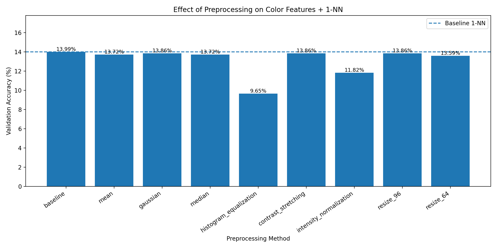
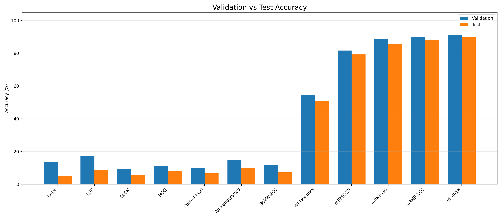
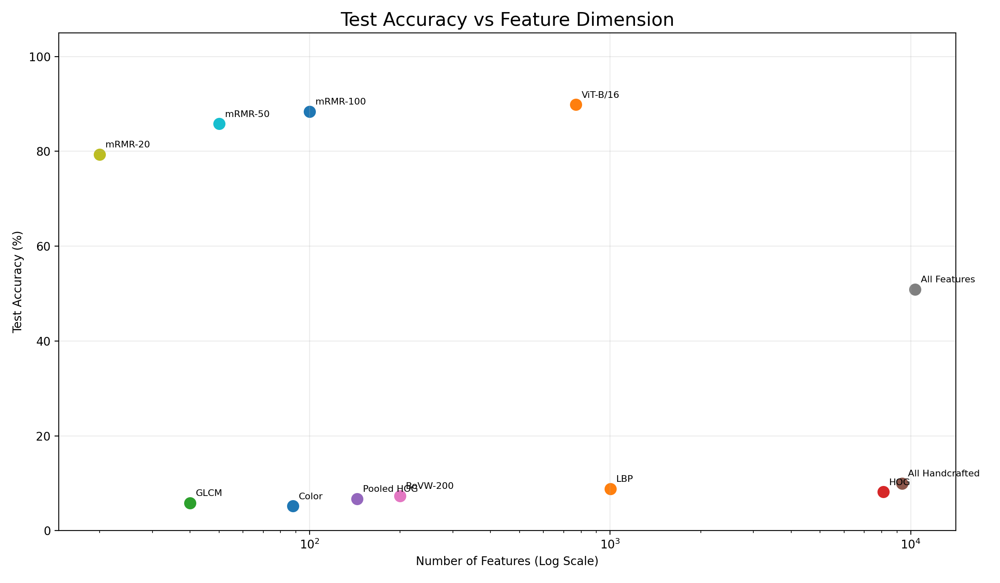
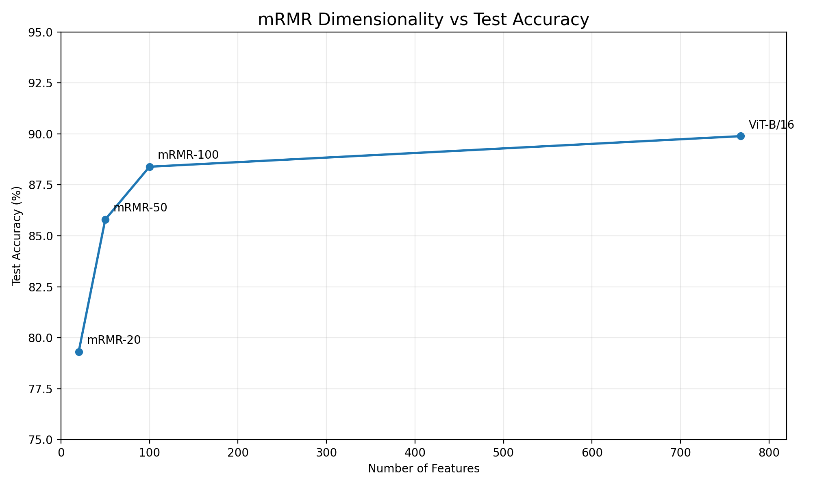
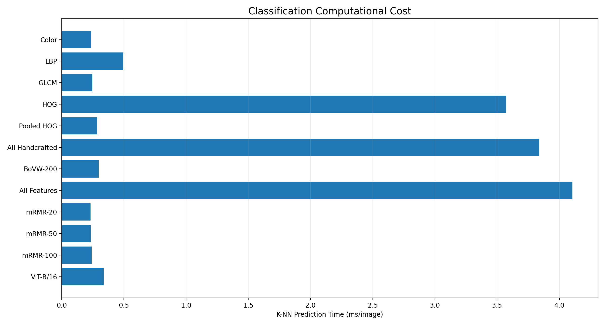
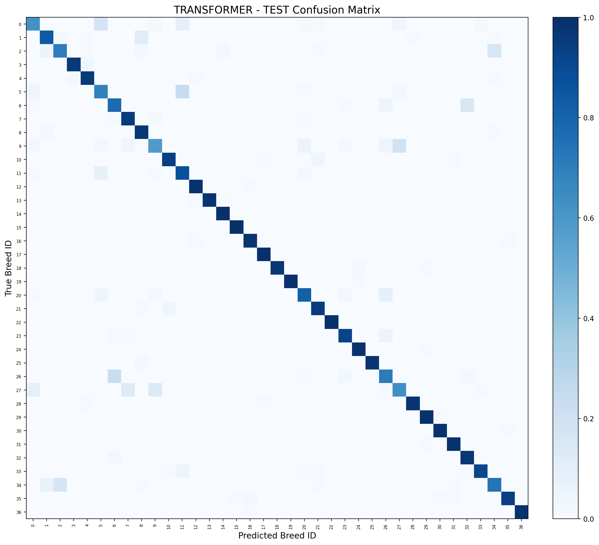

# CSE480 Machine Vision — Oxford-IIIT Pet Breed Classification

   

A reproducible comparison of **handcrafted image descriptors**, **SIFT Bag of Visual Words (BoVW)**, and **pretrained Vision Transformer embeddings**, evaluated with a **K-Nearest Neighbors (K-NN) classifier implemented from scratch**. Feature selection is investigated using **minimum Redundancy–Maximum Relevance (mRMR)**.

> **Key finding:** Frozen **ViT-B/16 + 5-NN (cosine distance)** achieved **89.89% accuracy and 0.8967 macro-F1** on the official 3,669-image test split. Selecting just 100 of its embedding dimensions with mRMR retained **88.39% accuracy**, reducing stored feature dimensionality by **86.98%** relative to the full ViT embedding.

## Contents

1. [Problem and dataset](#problem-and-dataset)
2. [Methodology](#methodology)
3. [Experimental results](#experimental-results)
4. [Graph-by-graph analysis](#graph-by-graph-analysis)
5. [Error analysis](#error-analysis)
6. [Computational cost and memory](#computational-cost-and-memory)
7. [Reproducibility and limitations](#reproducibility-and-limitations)
8. [Repository layout](#repository-layout)
9. [Setup and usage](#setup-and-usage)
10. [Conclusion](#conclusion)

## Problem and dataset

The task is **37-class fine-grained cat and dog breed classification** using the [Oxford-IIIT Pet Dataset](https://www.robots.ox.ac.uk/~vgg/data/pets/). Breeds can share coat color, texture, head shape, and body structure, making this a useful benchmark for the strengths and limitations of different image representations.

| Split | Images | Classes | Usage |
|:--|--:|--:|:--|
| Training | 2,944 | 37 | Feature selection, vocabulary fitting, K-NN reference examples, and standardization |
| Validation | 736 | 37 | K-NN hyperparameter and configuration selection |
| Official test | 3,669 | 37 | Final evaluation only |
| **Total** | **7,349** | **37** | |

The official *trainval* set was stratified into training (80%) and validation (20%) using random seed **42**. No image filenames overlap across splits. Test data was not used for K-NN tuning, mRMR fitting, or BoVW vocabulary training. Original dataset images are **not included in this repository**.

## Methodology

### Image preprocessing

The project examined a baseline resize to 128 × 128 and alternatives including mean, Gaussian, and median filtering, histogram equalization, contrast stretching, intensity normalization, and alternative resize dimensions. On validation, the **baseline color-feature pipeline yielded 13.99% 1-NN accuracy**, compared with **9.65%** for histogram equalization and **13.59–13.86%** for several alternatives. Accordingly, the baseline preprocessing was retained for the evaluated handcrafted feature pipelines. The pretrained ViT used its own **224 × 224 / ImageNet normalization** preprocessing, consistent with its pretrained weights.



**Interpretation:** Image processing operations are not automatically beneficial: a transformation that alters the distribution of colors or local texture may suppress cues needed to distinguish similar breeds. This experiment applies to the **color-feature 1-NN validation baseline**, not to every feature extractor or the ViT.

### Feature extraction and representation

| Representation | Dimensions | Description |
|:--|--:|:--|
| Color | 88 | RGB/HSV color statistics and normalized histograms |
| LBP | 1,003 | Uniform local binary pattern histograms, global and spatial-grid |
| GLCM | 40 | Quantized gray-level co-occurrence texture statistics |
| HOG | 8,100 | Gradient orientation histograms with block normalization |
| Pooled HOG | 144 | Spatially pooled gradient descriptor |
| All handcrafted | 9,375 | Concatenation of color, LBP, GLCM, HOG and pooled HOG |
| BoVW-200 | 200 | SIFT descriptors assigned to a training-fitted 200-word visual vocabulary |
| ViT-B/16 | 768 | Frozen ImageNet-pretrained Vision Transformer embedding |
| All features | 10,343 | All handcrafted + ViT + BoVW-200 |
| mRMR-20 / 50 / 100 | 20 / 50 / 100 | Training-selected columns from the 10,343-dimensional representation |

**Handcrafted features:** Color descriptors characterize channel distributions; LBP and GLCM capture local texture; HOG captures spatial edge and gradient structure. These representations do not learn task-specific semantic invariances from large-scale labeled data.

**SIFT + BoVW:** Local 128-dimensional SIFT descriptors were clustered using training descriptors only. Validation experiments considered vocabularies of 100, 200, and 500 visual words; **BoVW-200** was selected for subsequent concatenation and test comparison. Image descriptors are represented by normalized visual-word histograms.

**Pretrained ViT:** Torchvision's ImageNet-pretrained `vit_b_16` was used as a **frozen feature extractor** by removing its classification head. The 768-dimensional embedding was passed to the same from-scratch K-NN classifier. **No fine-tuning** was performed.

**mRMR:** Minimum Redundancy–Maximum Relevance selected informative, less redundant columns using the **training set only**. In the observed top-20, top-50, and top-100 solutions, **100% of selected features came from the ViT embedding**. This is a property of the tested scoring/configuration and data; it does not prove handcrafted features carry no useful information.

### Classification protocol

- K-NN distance computations and voting were implemented in NumPy rather than using a prebuilt K-NN classifier.
- Each representation was standardized using **training-set mean and standard deviation only**; validation and test were transformed using those same statistics.
- Validation searched **K ∈ {3, 5, 9, 15}** and **Euclidean or cosine distance**, alongside a 1-NN Euclidean baseline.
- Configuration choices were fixed **before the official test evaluation**.
- Metrics: **accuracy**, **macro-F1**, **confusion matrix**, and measured **K-NN prediction time per image**.

## Experimental results

### Full validation and official test comparison

| Feature set | Dimensions | Best validation accuracy | Test accuracy | Test macro-F1 |
|:--|--:|--:|--:|--:|
| Color | 88 | 13.59% | 5.18% | 0.0517 |
| LBP | 1,003 | 17.53% | 8.80% | 0.0889 |
| GLCM | 40 | 9.38% | 5.83% | 0.0582 |
| HOG | 8,100 | 11.14% | 8.15% | 0.0803 |
| Pooled HOG | 144 | 10.05% | 6.73% | 0.0675 |
| All handcrafted | 9,375 | 14.81% | 9.95% | 0.0993 |
| BoVW-200 | 200 | 11.68% | 7.30% | 0.0700 |
| All features | 10,343 | 54.62% | 50.89% | 0.5051 |
| mRMR-20 | 20 | 81.66% | 79.31% | 0.7848 |
| mRMR-50 | 50 | 88.45% | 85.80% | 0.8524 |
| mRMR-100 | 100 | 89.81% | **88.39%** | **0.8808** |
| **Frozen ViT-B/16** | **768** | **91.03%** | **89.89%** | **0.8967** |

**Interpretation:** The pretrained ViT representation clearly outperformed the individual handcrafted and BoVW descriptors in this setup. The full 10,343-dimensional concatenation did **not** improve on the ViT alone: test accuracy dropped to **50.89%**, even though more features were included. In distance-based models, standardized dimensions are not automatically equally informative; thousands of handcrafted dimensions can dominate or distort similarity measurements. The substantial validation-to-test declines for some handcrafted features (e.g., color **13.59% → 5.18%**, LBP **17.53% → 8.80%**) should be reported transparently rather than treated as evidence of a single confirmed cause. An audit found no label mismatches and recomputation matched stored handcrafted values in 20 sampled images per split, but this limited check cannot rule out all dataset-shift effects or other issues.

### Selected validation configurations

| Model | K | Distance | Test accuracy |
|:--|--:|:--|--:|
| Color | 3 | Euclidean | 5.18% |
| LBP | 3 | Cosine | 8.80% |
| GLCM | 9 | Euclidean | 5.83% |
| HOG | 5 | Cosine | 8.15% |
| Pooled HOG | 3 | Cosine | 6.73% |
| All handcrafted | 9 | Cosine | 9.95% |
| BoVW-200 | 5 | Cosine | 7.30% |
| All features | 15 | Cosine | 50.89% |
| mRMR-20 | 5 | Cosine | 79.31% |
| mRMR-50 | 5 | Cosine | 85.80% |
| mRMR-100 | 3 | Cosine | 88.39% |
| **ViT-B/16** | **5** | **Cosine** | **89.89%** |

## Graph-by-graph analysis

### 1. Validation vs. test accuracy



**What the graph shows:** Each pair of bars compares the best validation configuration for a feature family against its official test accuracy. The **ViT** decreased from **91.03% to 89.89%** (−1.14 percentage points); **mRMR-100** decreased from **89.81% to 88.39%** (−1.42 pp). By contrast, **color** declined by **8.41 pp** and **LBP** by **8.73 pp**.

**What this means:** In these experiments, ViT and mRMR-100 retained their performance more consistently across the chosen splits. The larger handcrafted-feature drops indicate sensitivity to the evaluation split, but do not by themselves identify the mechanism. Validation results were used for model selection; test results were used to report the final selected configurations.

### 2. Accuracy vs. feature dimensionality



**What the graph shows:** The horizontal axis is logarithmic because descriptors range from **20 to 10,343 dimensions**. Despite having the most features, **All features (10,343)** achieved only **50.89%**, whereas **ViT (768)** achieved **89.89%**, and **mRMR-100 (100)** achieved **88.39%**.

**What this means:** Dimensionality alone is a poor proxy for usefulness. Informative features are more valuable than simply concatenating additional, heterogeneous dimensions. This plot is an empirical comparison of configurations, **not** a controlled experiment demonstrating that dimensionality itself caused the performance differences.

### 3. mRMR feature count vs. accuracy



| ViT-derived representation | Dimensions | Test accuracy | Loss vs. full ViT |
|:--|--:|--:|--:|
| mRMR-20 | 20 | 79.31% | 10.58 pp |
| mRMR-50 | 50 | 85.80% | 4.09 pp |
| mRMR-100 | 100 | 88.39% | 1.50 pp |
| Full ViT | 768 | 89.89% | — |

**What the graph shows:** Most of the gain from retaining more selected dimensions occurs between 20 and 100 features. Moving from **100 to 768 features** increases accuracy by only **1.50 percentage points** in this comparison. The mRMR-100 vector uses **86.98% fewer dimensions** than the original ViT embedding and **99.03% fewer dimensions** than the complete concatenated representation.

**What this means:** mRMR-100 offers a compelling **feature-storage / K-NN-cost trade-off**. Crucially, **all 100 selected columns are ViT-derived**. Computing those columns for a new image still requires running the **full frozen ViT**; this is **not** an 86.98% reduction in neural-network inference time.

### 4. K-NN classification time



**What the graph shows:** Measured K-NN prediction time rises substantially for the large concatenated vectors: **4.106 ms/image** for All features, versus **0.339 ms/image** for full ViT and **0.242 ms/image** for mRMR-100. On these runs, the mRMR-100 K-NN stage was approximately **1.40× faster** than full ViT K-NN (0.339 / 0.242).

**What this means:** Smaller vectors reduce the amount of data processed by nearest-neighbor search, although measured runtime is also affected by implementation, cache behavior, hardware, and measurement noise. These times **exclude loading, preprocessing, and feature extraction**, so the graph does **not** compare end-to-end image-inference latency.

## Error analysis

### ViT confusion matrix



The frozen ViT + 5-NN model correctly classified **3,298 / 3,669** test images, leaving **371 errors**. The row-normalized confusion matrix reveals which true breeds are frequently assigned to another class, rather than only the total accuracy.

**Lowest-performing true breeds (ViT):**

| True breed | Correct classification rate | Incorrect images |
|:--|--:|--:|
| British Shorthair | 58.00% | 42 |
| Abyssinian | 62.24% | 37 |
| Russian Blue | 63.00% | 37 |
| Bengal | 68.00% | 32 |
| American Pit Bull Terrier | 70.00% | 30 |
| Ragdoll | 71.00% | 29 |

**Most frequent directional confusions (ViT):**

| True breed | Predicted breed | Test images |
|:--|:--|--:|
| Bengal | Egyptian Mau | 24 |
| Ragdoll | Birman | 23 |
| British Shorthair | Russian Blue | 19 |
| Abyssinian | Bengal | 17 |
| American Pit Bull Terrier | Staffordshire Bull Terrier | 16 |
| Birman | Siamese | 16 |

**Interpretation:** Many confusion pairs involve breeds that can share visible characteristics (e.g., spotted coats, similar gray coloring, or comparable body/head shapes). These are **plausible visual explanations**, not proven causal diagnoses: image-by-image inspection is needed to assess individual mistakes, pose, occlusion, background, and image quality. Confusions are **directional**; “Bengal → Egyptian Mau” does not imply the reverse occurs equally often.

### Examples of misclassified images

**Local-only visual inspection:** `results/figures/transformer_misclassifications.png` (not published in this image-free repository).

The locally generated figure presents **12 selected misclassified test images**: two examples from each of the six most frequent directional confusion pairs. They are useful for **qualitative diagnosis** but are **not** a random sample of all 371 errors. Captions show the true and predicted classes. Keep this figure locally because it contains original pet photographs, even though its file format is PNG.

For more detail, see [`results/tables/transformer_per_breed.csv`](results/tables/transformer_per_breed.csv) and [`results/tables/transformer_top_confusions.csv`](results/tables/transformer_top_confusions.csv).

## Computational cost and memory

The values below describe **float32 feature-vector storage** and **measured K-NN timing**; they do **not** include peak RAM consumption of the running Python or PyTorch process.

| Model | Dimensions | Feature vector size | Train matrix size | Test matrix size | K-NN ms/image |
|:--|--:|--:|--:|--:|--:|
| Color | 88 | 0.34 KiB | 0.99 MiB | 1.23 MiB | 0.238 |
| LBP | 1,003 | 3.92 KiB | 11.26 MiB | 14.04 MiB | 0.496 |
| GLCM | 40 | 0.16 KiB | 0.45 MiB | 0.56 MiB | 0.246 |
| HOG | 8,100 | 31.64 KiB | 90.97 MiB | 113.37 MiB | 3.575 |
| Pooled HOG | 144 | 0.56 KiB | 1.62 MiB | 2.02 MiB | 0.283 |
| All handcrafted | 9,375 | 36.62 KiB | 105.29 MiB | 131.21 MiB | 3.840 |
| BoVW-200 | 200 | 0.78 KiB | 2.25 MiB | 2.80 MiB | 0.297 |
| All features | 10,343 | 40.40 KiB | 116.16 MiB | 144.76 MiB | 4.106 |
| mRMR-20 | 20 | 0.08 KiB | 0.22 MiB | 0.28 MiB | 0.231 |
| mRMR-50 | 50 | 0.20 KiB | 0.56 MiB | 0.70 MiB | 0.234 |
| mRMR-100 | 100 | 0.39 KiB | 1.12 MiB | 1.40 MiB | 0.242 |
| ViT-B/16 | 768 | 3.00 KiB | 8.62 MiB | 10.75 MiB | 0.339 |

**Interpretation:** The full 10,343-column representation requires **40.40 KiB/image**, while mRMR-100 requires **0.39 KiB/image**; the full ViT representation takes **3.00 KiB/image**. These differences matter when storing a large reference database for K-NN or loading it into memory. Actual memory use also includes temporary arrays, indices, model weights, and the feature-extraction network itself.

### Handcrafted / BoVW extraction time (test measurements)

| Extractor | Extraction time (ms/image) |
|:--|--:|
| Color | 3.853 |
| LBP | 4.371 |
| GLCM | 1.238 |
| HOG + pooled HOG (shared computation) | 4.674 |
| SIFT + BoVW-200 | 6.207 |

These timings **exclude image loading and resizing**, and the HOG and pooled HOG values **share one extraction operation**, so they should not be added together. ViT feature extraction timings were not reported on the same measurement basis here. Consequently, no fair **end-to-end** throughput comparison is claimed.

Complete tables: [`computational_cost_comparison.csv`](results/tables/computational_cost_comparison.csv), [`final_test_results.csv`](results/tables/final_test_results.csv), and [`remaining_final_test_results.csv`](results/tables/remaining_final_test_results.csv).

## Reproducibility and limitations

- **Dataset integrity:** 2,944 training / 736 validation / 3,669 test samples, with 37 classes in each and **no split overlap**, verified by the project audit.
- **Labels:** Official annotation labels match the split labels for all samples.
- **Feature consistency:** Recomputed handcrafted features matched stored arrays on **20 sampled images per split** across color, LBP, GLCM, HOG and pooled HOG. This is a **sampled** integrity check, not exhaustive image-by-image verification.
- **mRMR consistency:** The saved selected-feature matrices matched the corresponding ViT columns exactly (reported maximum absolute difference **0.00000000** on train, validation, and test).
- **Unit tests:** **32 passed** for color, LBP, GLCM, and HOG. Demo scripts are kept separately under `scripts/demos/`.
- **Environment:** Ubuntu Linux; Python **3.10.12**; NumPy **1.24.4**; scikit-learn **1.7.2**; PyTorch **2.9.1**; torchvision **0.24.1**; CUDA-enabled **RTX 3060 Laptop GPU**.
- **Pretrained weights:** ViT weights are downloaded through Torchvision on first use and are **not committed**.
- **Large data:** Dataset photographs, `.npy`/`.npz` feature matrices, model weights, and local caches are excluded from Git. Commit only **non-photographic** figures (charts and heatmaps); exclude image montages such as `transformer_misclassifications.png`, `sift_keypoints.png`, and `preprocessing_comparison.png`.
- **Known limitations:** Handcrafted results are low and some validation-to-test gaps are sizeable; benchmark conclusions concern the **tested pipeline**, not all implementations of those descriptor families. Reported inference timings exclude feature extraction. No claims of statistically significant model differences or real-time end-to-end performance are made.

See [`results/tables/project_audit.json`](results/tables/project_audit.json) for the saved audit metadata.

## Repository layout

```text
cv_project/
├── dataset.py                  # Dataset split creation
├── preprocessing.py            # Shared preprocessing helpers
├── requirements.txt
├── src/
│   ├── classifiers/knn.py     # K-NN from scratch
│   └── features/               # Color, LBP, GLCM, HOG, SIFT
├── scripts/
│   ├── extraction/             # Feature extraction, BoVW, concatenation, mRMR
│   ├── evaluation/             # Validation / final-test evaluation
│   ├── experiments/            # Preprocessing and tuning experiments
│   ├── analysis/               # Auditing, error and cost analysis
│   ├── visualization/          # Performance plots and examples
│   └── demos/                  # Standalone demonstrations
├── tests/                      # Unit tests
├── data/splits/                # Split metadata (arrays generated locally)
├── features/                   # Dictionary JSONs; numeric arrays generated locally
└── results/
    ├── figures/               # Charts and confusion matrices
    └── tables/                # CSV/JSON evaluation and audit outputs
```

## Setup and usage

```bash
git clone https://github.com/fawky112/cv_project.git
cd cv_project
python3 -m venv .venv
source .venv/bin/activate
python -m pip install -r requirements.txt
```

For GPU extraction, configure the appropriate PyTorch/CUDA build for your hardware. The published `requirements.txt` should be reviewed and tested in a fresh environment before it is treated as a version-locked reproduction specification.

### Prepare the dataset

Download the Oxford-IIIT Pet images and annotations from the [official dataset page](https://www.robots.ox.ac.uk/~vgg/data/pets/). The original experiments expected them at:

```text
~/Downloads/oxford-iiit-pet/
  images/
  annotations/
```

From the repository root, generate the split files:

```bash
python dataset.py
```

### Run unit tests and sanity checks

```bash
python -m pytest tests/ -v
python -m compileall -q src scripts tests
```

After regenerating feature arrays and selections, run the project audit:

```bash
python -m scripts.analysis.audit_project
```

### Run experiments

Scripts are organized as Python modules; execute them **from the repository root**. For example:

```bash
# 1) Handcrafted example
python -m scripts.extraction.extract_color_dataset
python -m scripts.evaluation.evaluate_color

# 2) Pretrained ViT representations
python -m scripts.extraction.extract_transformer
python -m scripts.evaluation.evaluate_transformer

# 3) Feature selection and selected-vector evaluation
# Requires the prerequisite feature matrices and full concatenation.
python -m scripts.extraction.combine_all_features
python -m scripts.extraction.select_mrmr
python -m scripts.evaluation.evaluate_mrmr

# 4) Final test, after test feature extraction and selection are complete
python -m scripts.extraction.extract_transformer_test
python -m scripts.extraction.prepare_mrmr_test
python -m scripts.evaluation.evaluate_final_test

# 5) Recreate final plots from saved CSV results
python -m scripts.visualization.generate_final_figures
```

**Execution order matters:** `combine_all_features` requires training and validation features for all its constituent representations, including the BoVW vocabulary/histograms. The final-test scripts require previously generated test feature arrays. The committed CSV/JSON results can be inspected **without** recomputing the feature matrices. Some scripts contain local dataset-path assumptions; adjust those paths if the dataset is stored elsewhere.

## Conclusion

The experiments show that a **frozen ImageNet-pretrained ViT representation** provides a much stronger basis for fine-grained pet breed classification with K-NN than the tested handcrafted and SIFT-BoVW feature representations. Combining every feature did not improve accuracy, illustrating that adding dimensions may degrade similarity quality. **mRMR-100** retained **88.39%** test accuracy with a much smaller stored representation, offering a useful **storage and K-NN computation** trade-off. The remaining challenges are understanding visually ambiguous breed errors, improving fairness of end-to-end runtime comparisons, and evaluating generalization beyond the current dataset split.
